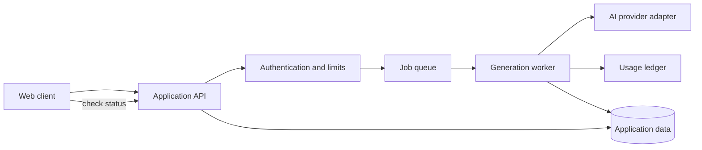

# Harmonif Engineering Showcase

A sanitized engineering case study demonstrating selected patterns for an AI-powered content creation platform.

> This repository is an independent showcase. It is not the Harmonif application source code and is not intended to run the production service.

## Engineering areas

- **AI provider abstraction:** isolate vendor-specific request and response handling behind a stable application interface.
- **Background processing:** model long-running generation work as jobs with explicit states and bounded retry policies.
- **Credit accounting:** represent usage as an append-only ledger rather than relying only on a mutable balance.
- **API resilience:** validate requests, apply rate limits, and return predictable errors.
- **Operational visibility:** use stable job identifiers and structured status information so clients can follow generation progress.

## Architecture

## Repository map

- `docs/architecture.md` — design boundaries and lifecycle.
- `examples/credit-ledger.ts` — framework-independent usage accounting example.
- `examples/generation-job.ts` — job state model and retry policy.

## Key design decisions

1. Reserve usage before dispatching work and settle it after the outcome is known.
2. Make job transitions explicit and reject invalid transitions.
3. Keep provider credentials and vendor-specific payloads on the server.
4. Retry transient failures only, with bounded attempts and elapsed time.
5. Use idempotency keys to prevent duplicate charging when clients retry requests.

## Running the examples

The examples are dependency-free TypeScript snippets intended for a recent TypeScript project. They are reference implementations, not a complete application.

## Security and privacy

All names, identifiers, and records are synthetic. No production credentials, customer records, private endpoints, proprietary prompts, or production database definitions are included.

## About

Harmonif is an AI content creation product. This repository presents selected engineering concepts while keeping the actual product implementation private.
